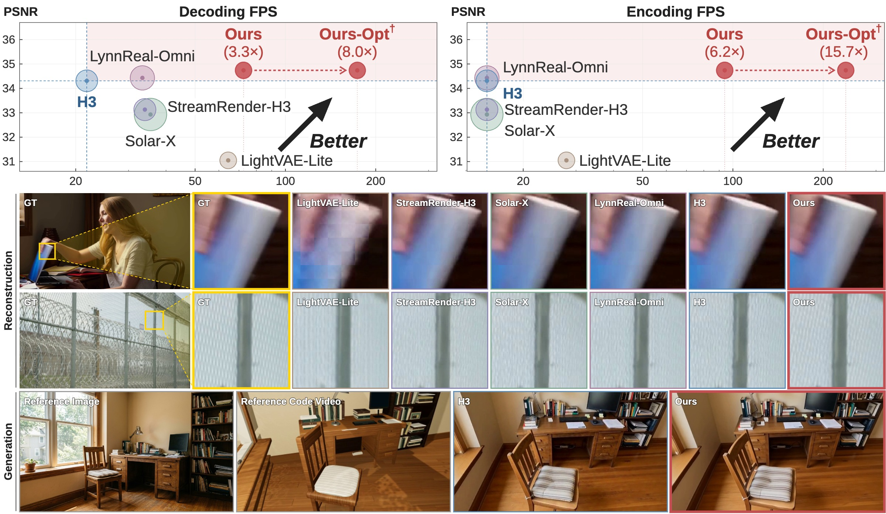
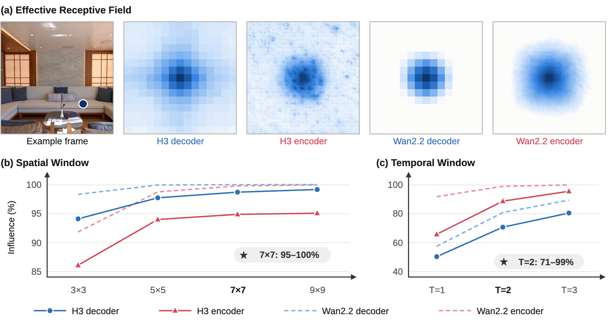
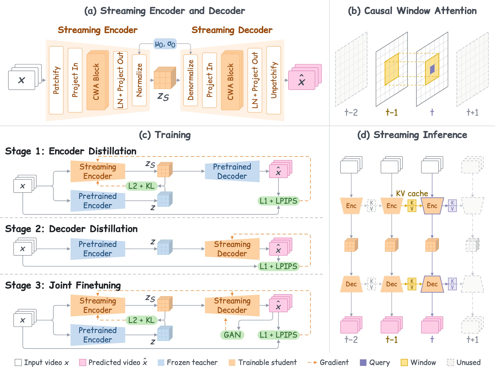

<h1 align="center">LiveVAE: Causal Window Attention Makes Efficient Streaming Video VAE</h1>

<p align="center">
  <a href="https://ddxsg24.github.io/">Jiachen An</a><sup>1,2,4,*</sup> ·
  <a href="https://sijeh.github.io/">Sijie Zhao</a><sup>2,*</sup> ·
  <a href="https://github.com/lile839">Le Li</a><sup>2,*</sup> ·
  <a href="https://kumapowerliu.github.io/">Hongyu Liu</a><sup>2,3</sup> ·
  <a href="https://huai-chang.github.io/">Zhiyuan Li</a><sup>1,2,4</sup> ·
  <a href="https://tianyu-yang.com/">Tianyu Yang</a><sup>2</sup><br>
  <a href="https://scholar.google.com/citations?user=28FH5F0AAAAJ">Xiaoyu Kong</a><sup>2</sup> ·
  <a href="https://scholar.google.com/citations?user=ZEAfy1QAAAAJ">Xunliang Cai</a><sup>2</sup> ·
  <a href="https://auto202603.github.io/">Yong Zhang</a><sup>2,‡</sup> ·
  <a href="https://cmpun.github.io/">Chi-Man Pun</a><sup>4,†</sup> ·
  <a href="https://scholar.google.com/citations?user=JXV5yrZxj5MC">Xiaoming Wei</a><sup>2,†</sup> ·
  <a href="https://vinthony.github.io/academic/">Xiaodong Cun</a><sup>1,†</sup>
</p>

<p align="center">
  <sup>1</sup>GVC Lab, Great Bay University &nbsp; <sup>2</sup>Meituan &nbsp;
  <sup>3</sup>The Hong Kong University of Science and Technology &nbsp; <sup>4</sup>University of Macau<br>
  <sup>*</sup>Equal contribution &nbsp; <sup>†</sup>Corresponding authors &nbsp; <sup>‡</sup>Project lead
</p>

<p align="center">
  <a href="https://livevae.github.io/"><b>Project page</b></a> ·
  Paper (coming soon) ·
  Models (coming soon)
</p>

<p align="center">
  
</p>

LiveVAE is a streaming video VAE: an encoder and a decoder built on causal window attention. It is distilled from a
pretrained video VAE and keeps that VAE's latent space, so it replaces the original encoder and decoder directly,
with no change to the diffusion model.

In the MiniMax-H3 latent space, on one NVIDIA H100:

- **5.2–6.2× faster encoding** than the official VAE.
- **3.0–3.3× faster decoding**, with higher PSNR.
- **Up to 13.4× faster end to end** with our inference optimizations, at almost no quality loss.

> [!NOTE]
> This repository is being prepared for release. The inference code and model weights will be added in a later
> update. Until then, the [project page](https://livevae.github.io/) has the full set of video comparisons.

## Why a window is enough

Existing video VAEs and their fast variants rely on heavy convolutions or full frame attention. We measured the
effective receptive fields of the pretrained MiniMax-H3 and Wan2.2 VAEs and found that both encoding and decoding
depend almost entirely on spatial and temporal neighbors:

- A **7 × 7** spatial window holds 95–100% of the influence on a latent.
- The current and previous latent frames (**T = 2**) hold 71–99% of it.

<p align="center">
  
</p>

## Method

<p align="center">
  
</p>

- **Streaming encoder and decoder (a).** Both are transformers made of causal window attention (CWA) blocks between
  a patchify and an unpatchify layer. The encoder output is normalized with the latent statistics of the pretrained
  VAE.
- **Causal window attention (b).** A query in frame *t* attends to the 7 × 7 window around it in frame *t* and to
  the same window in frame *t* − 1. Later frames are masked. This cuts the compute per frame and fixes how far back
  the model looks.
- **Training (c).** Three stages keep the pretrained latent space:
  1. *Encoder distillation.* The streaming encoder learns to match the latents of the pretrained encoder (L2 + KL),
     with a reconstruction loss (L1 + LPIPS) through the frozen pretrained decoder.
  2. *Decoder distillation.* The streaming decoder learns to reconstruct video from the latents of the frozen
     pretrained encoder (L1 + LPIPS).
  3. *Joint finetuning.* Both are trained together with the same losses plus a GAN loss.
- **Streaming inference (d).** Each frame computes its keys and values once and stores them in a one frame KV cache.
  The next frame reads them from the cache, so memory stays constant however long the video is. The encoder and the
  decoder each keep their own cache.

On top of this, LiveVAE-Opt adds three inference optimizations: fused attention kernels, region-wise compilation and
an FP8 feedforward path trained with quantization-aware training.

## Speed

End to end time at 720p on one NVIDIA H100 with batch size 1, as the median latency after warm up. Clips have 22
frames (21 for Wan2.2). Decoder only methods keep the official encoder, so their speedup includes the official
encoder time.

**MiniMax-H3 latent space**

| Method | Replaces | Encoder (ms) | Decoder (ms) | Speedup | PSNR (dB) |
|---|---|---:|---:|---:|---:|
| MiniMax-H3 (official) | — | 1453.5 | 1010.6 | 1.0× | 34.31 |
| TAEH3 | Encoder + decoder | 15.4 | 20.3 | 69.0× | 28.72 |
| LightVAE-Lite | Encoder + decoder | 789.5 | 341.3 | 2.2× | 31.05 |
| LynnReal-Omni | Decoder only | — | 659.5 | 1.2× | 34.43 |
| Solar-X | Decoder only | — | 619.7 | 1.2× | 32.93 |
| StreamRender-H3 | Decoder only | — | 647.0 | 1.2× | 33.13 |
| **LiveVAE** | Encoder + decoder | 234.3 | 303.4 | **4.6×** | **34.74** |
| **LiveVAE-Opt** | Encoder + decoder | 92.5 | 126.7 | **11.2×** | **34.74** |

**Wan2.2 latent space**

| Method | Replaces | Encoder (ms) | Decoder (ms) | Speedup | PSNR (dB) |
|---|---|---:|---:|---:|---:|
| Wan2.2 (official) | — | 382.8 | 1264.2 | 1.0× | 37.66 |
| TAEW2.2 | Encoder + decoder | 17.9 | 22.8 | 40.5× | 31.49 |
| TAEW2.2-Super | Encoder + decoder | 18.0 | 46.8 | 25.4× | 32.89 |
| LightTAE | Encoder + decoder | 18.4 | 23.2 | 39.6× | 28.88 |
| LightVAE-Lite | Decoder only | — | 438.5 | 2.0× | 34.28 |
| LightVAE-Pro | Decoder only | — | 786.2 | 1.4× | 36.91 |
| Turbo-VAED | Decoder only | — | 708.7 | 1.5× | 34.37 |
| **LiveVAE** | Encoder + decoder | 261.5 | 254.9 | **3.2×** | 36.24 |

The 480p, 1080p and 2160p numbers are on the [project page](https://livevae.github.io/#speed). The 13.4× speedup of
LiveVAE-Opt is measured at 1080p.

## Results

These are short previews. The [project page](https://livevae.github.io/#results) plays every comparison at full
quality.

**Reconstruction** (MiniMax-H3 latent space). Top: ground truth and LiveVAE, with the zoomed region marked. Bottom,
left to right: ground truth, MiniMax-H3, TAEH3, LightVAE-Lite, LynnReal-Omni, Solar-X, StreamRender-H3, LiveVAE.

<p align="center">
  
</p>

**Reference to video.** Left to right: reference image, code video, generation decoded by the MiniMax-H3 VAE, the
same latents decoded by LiveVAE.

<p align="center">
  
</p>

**Text to video.** The same latents decoded by the MiniMax-H3 VAE (left) and by LiveVAE (right).

<p align="center">
  
</p>

## Citation

```bibtex
@article{an2026livevae,
  title   = {LiveVAE: Causal Window Attention Makes Efficient Streaming Video VAE},
  author  = {An, Jiachen and Zhao, Sijie and Li, Le and Liu, Hongyu and Li, Zhiyuan and
             Yang, Tianyu and Kong, Xiaoyu and Cai, Xunliang and Zhang, Yong and
             Pun, Chi-Man and Wei, Xiaoming and Cun, Xiaodong},
  journal = {arXiv preprint},
  year    = {2026},
  url     = {https://livevae.github.io/}
}
```

Questions are welcome through the [issue tracker](https://github.com/MeiGen-AI/LiveVAE/issues).
